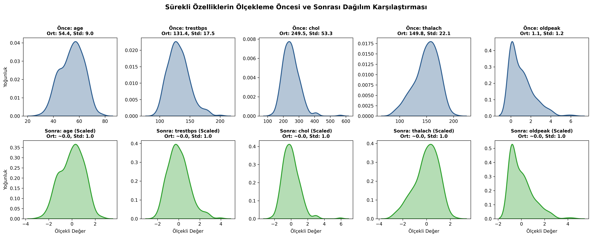
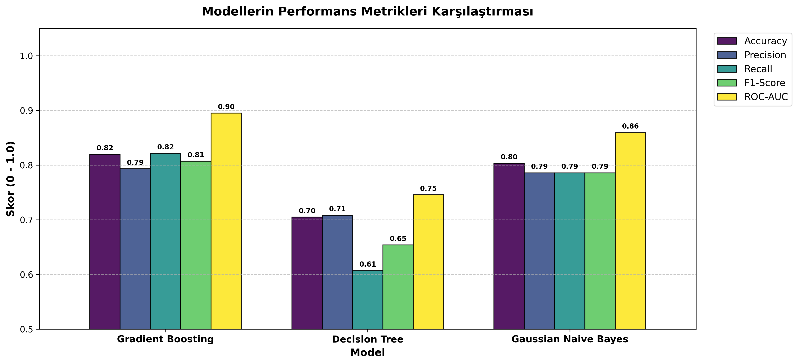
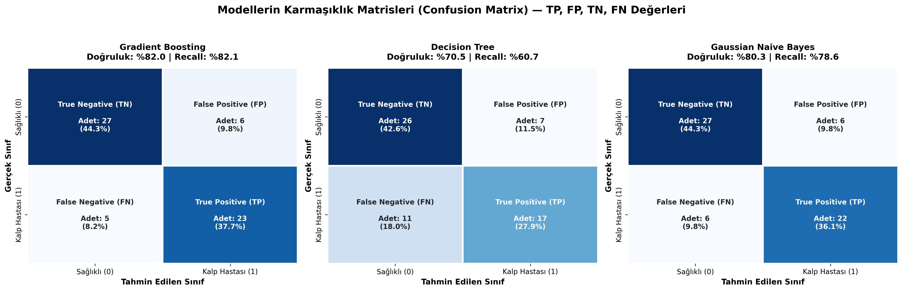
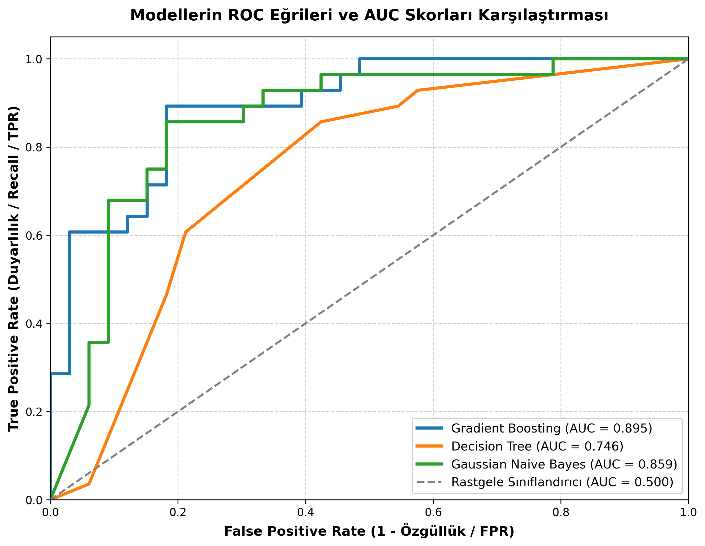
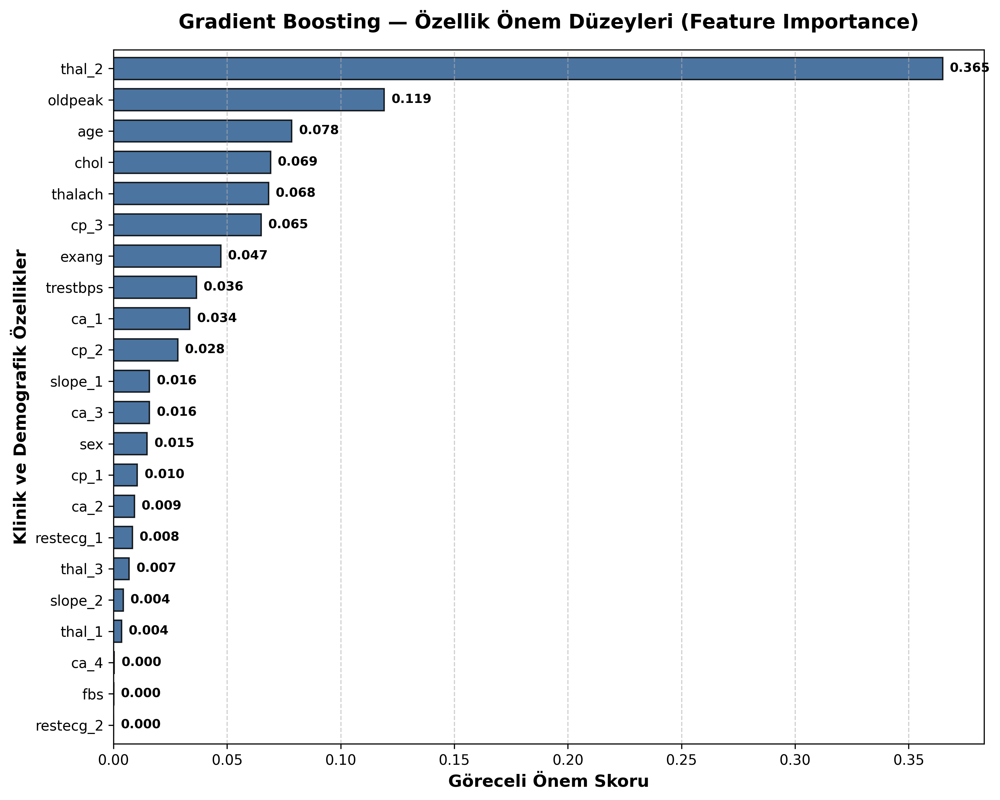

# 🫀 Heart Disease Prediction — Makine Öğrenmesi & Veri Madenciliği

> **Makine Öğrenmesi & Veri Madenciliği Projesi — 2026**  
> Python • Scikit-Learn • Pandas • Seaborn • Matplotlib • Jupyter Notebook  
> UCI Cleveland Heart Disease veri seti ile ikili sınıflandırma: üç modelin karşılaştırılması

[](https://www.python.org/)
[](https://scikit-learn.org/)
[](https://pandas.pydata.org/)
[](https://jupyter.org/)
[](https://opensource.org/licenses/MIT)

---

## 👤 Geliştirici

| İsim | Bölüm | GitHub | LinkedIn | İletişim / E-Posta |
|------|-------|--------|----------|-------------------|
| **Hüseyin Konak** | Bilgisayar Mühendisliği | [@huseyin-konak](https://github.com/huseyin-konak) | [linkedin.com/in/huseyin-konak](https://www.linkedin.com/in/huseyin-konak/) | [huseyinkonak.dev@gmail.com](mailto:huseyinkonak.dev@gmail.com) |

---

## 📑 İçindekiler

1. [Proje Hakkında](#-proje-hakkında)
2. [Sistem Mimarisi & Pipeline Akışı](#-sistem-mimarisi--pipeline-akışı)
3. [Veri Seti Tanımı ve Klinik Nitelikler](#-veri-seti-tanımı-ve-klinik-nitelikler)
4. [Veri Ön İşleme (Pre-processing)](#-veri-ön-işleme-pre-processing)
5. [Eğitilen Modeller](#-eğitilen-modeller)
6. [Performans Karşılaştırması ve Metrikler](#-performans-karşılaştırması-ve-metrikler)
7. [Karmaşıklık Matrisi (Confusion Matrix) & TP-FP-TN-FN Analizi](#-karmaşıklık-matrisi-confusion-matrix--tp-fp-tn-fn-analizi)
8. [ROC Eğrileri ve AUC Analizi](#-roc-eğrileri-ve-auc-analizi)
9. [Özellik Önemi (Feature Importance) ve Klinik Çıkarımlar](#-özellik-önemi-feature-importance-ve-klinik-çıkarımlar)
10. [Sınırlamalar](#-sınırlamalar)
11. [Proje Dizin Yapısı](#-proje-dizin-yapısı)
12. [Kurulum ve Çalıştırma](#-kurulum-ve-çalıştırma)

---

## 🎯 Proje Hakkında

Bu proje, bireylerin klinik test, efor ve demografik verilerini kullanarak **kalp hastalığı varlığını (1: Hasta, 0: Sağlıklı)** tahmin eden uçtan uca bir makine öğrenmesi ve veri madenciliği çalışmasıdır.

Kardiyovasküler hastalıklar küresel olarak en yaygın ölüm nedenlerinden biridir. Tıbbi tanıda **False Negative (hastaya yanlışlıkla sağlıklı demek)** en riskli hata olduğundan, modeller yalnızca doğrulukla (Accuracy) değil; **Duyarlılık (Recall)** ve **ROC-AUC** metrikleriyle de karşılaştırılmıştır.

---

## 🏗 Sistem Mimarisi & Pipeline Akışı

```
┌─────────────────────────────────────────────────────────────────────────┐
│               UÇTAN UCA MAKİNE ÖĞRENMESİ PİPELİNE AKIŞI                 │
│                                                                         │
│   ┌─────────────────────┐                                               │
│   │ Veri Yükleyici      │  pandas.read_csv() + yerel önbellek           │
│   └──────────┬──────────┘                                               │
│   ┌──────────▼──────────┐                                               │
│   │ Keşifçi Veri        │  - Eksik değer ve eksik değer kodları         │
│   │ Analizi (EDA)       │  - Hedef etiketin doğrulanması                │
│   │                     │  - Kutu grafiği ile aykırı değer analizi      │
│   └──────────┬──────────┘                                               │
│   ┌──────────▼──────────┐                                               │
│   │ Veri Ön İşleme      │  - One-Hot Encoding (drop_first=True)         │
│   │                     │  - Train/Test Split (%80 - %20, stratify)     │
│   │                     │  - StandardScaler (yalnızca eğitime fit)      │
│   └──────────┬──────────┘                                               │
│              ├──────────────────┬──────────────────┐                    │
│   ┌──────────▼──────────┐ ┌─────▼──────────┐ ┌─────▼──────────┐         │
│   │ Gradient Boosting   │ │ Decision Tree  │ │ Gaussian Naive │         │
│   │ Classifier          │ │ Classifier     │ │ Bayes          │         │
│   └──────────┬──────────┘ └─────┬──────────┘ └─────┬──────────┘         │
│   ┌──────────▼──────────────────▼──────────────────▼──────────┐         │
│   │ Değerlendirme & Görselleştirme                            │         │
│   │ - Test seti metrikleri + 5 katlı çapraz doğrulama         │         │
│   │ - Confusion Matrix (TP, FP, TN, FN etiketli)              │         │
│   │ - Karşılaştırmalı ROC-AUC eğrileri                        │         │
│   │ - Gradient Boosting özellik önemi                         │         │
│   └───────────────────────────────────────────────────────────┘         │
└─────────────────────────────────────────────────────────────────────────┘
```

---

## 📊 Veri Seti Tanımı ve Klinik Nitelikler

Veri seti 303 örnek ve 14 öznitelikten oluşur. Kullanılan CSV, UCI Cleveland veri setinin Kaggle'da yaygın olarak kullanılan, **yeniden kodlanmış** kopyasıdır. Aşağıdaki değer kodları bu CSV'deki gerçek dağılımlara göre verilmiştir:

| Nitelik | Tanım | Değer Aralığı / Tür |
|---------|-------|---------------------|
| `age` | Yaş | 29 - 77 (Yıl) |
| `sex` | Cinsiyet | 1 = Erkek, 0 = Kadın |
| `cp` | Göğüs Ağrısı Tipi | 0: Asemptomatik, 1: Atipik Angina, 2: Non-anginal, 3: Tipik Angina |
| `trestbps` | Dinlenme Kan Basıncı | mm Hg |
| `chol` | Serum Kolesterolü | mg/dl |
| `fbs` | Açlık Kan Şekeri > 120 mg/dl | 1 = Doğru, 0 = Yanlış |
| `restecg` | Dinlenme EKG Sonuçları | 0, 1, 2 (normal / ST-T anormalliği / sol ventrikül hipertrofisi) |
| `thalach` | Ulaşılan Maksimum Kalp Hızı | Nabız |
| `exang` | Egzersiz Kaynaklı Angina | 1 = Evet, 0 = Hayır |
| `oldpeak` | Egzersiz Kaynaklı ST Çökmesi | Dinlenmeye göre depresyon miktarı |
| `slope` | Tepe Egzersiz ST Segment Eğimi | 0, 1, 2 |
| `ca` | Floroskopi ile Boyanan Ana Damar Sayısı | 0 - 3 (4 = eksik değer, 5 kayıt) |
| `thal` | Talyum Stres Testi Sonucu | 1: Sabit defekt, 2: Normal, 3: Geri dönüşümlü defekt (0 = eksik değer, 2 kayıt) |
| **`target`** | **Hedef Değişken (Teşhis)** | **Analizde: 1 = Kalp Hastalığı Var, 0 = Yok** |

> [!IMPORTANT]
> **Hedef etiket düzeltmesi:** Bu CSV'de ham `target = 1` olan grupta maksimum nabız daha yüksek (158'e karşı 139), ST çökmesi daha düşük (0,58'e karşı 1,59), efor anjinası (%14'e karşı %55) ve tıkalı damar sayısı (0,36'ya karşı 1,17) daha azdır; asemptomatik göğüs ağrısı (`cp = 0`) ise çoğunlukla `target = 0` grubundadır. Orijinal UCI verisinde bu bulguların tamamı **hastalıkla** ilişkilidir. Yani bu sürümde ham `target = 1`, klinik olarak "hastalık yok" anlamına gelir. Analizde hedef `1 - target` ile çevrilerek **1 = hasta** yapılmıştır (`src/preprocessor.py → fix_target_labels`).

---

## ⚙️ Veri Ön İşleme (Pre-processing)

1. **Eksik Değer Analizi:** CSV'de boş (NaN) hücre yoktur; ancak orijinal veri setindeki eksik değerler `ca = 4` (5 kayıt) ve `thal = 0` (2 kayıt) kodlarıyla temsil edilir. Bu 7 kayıt (%2) one-hot kodlamada ayrı bir kategori olarak tutulmuştur.
2. **Aykırı Değer Analizi (IQR):** Sürekli değişkenler kutu grafikleriyle (1,5 × IQR sınırları) taranmış; değerler fizyolojik olarak mümkün olduğundan veri setinden çıkarılmamıştır.
3. **One-Hot Encoding:** Çok kategorili değişkenler (`cp`, `restecg`, `slope`, `ca`, `thal`) için dummy sütunlar türetilmiş, çoklu doğrusal bağlantıyı önlemek için `drop_first=True` kullanılmıştır.
4. **Veri Sızıntısı (Data Leakage) Koruması:** `StandardScaler` **yalnızca eğitim setine** `fit` edilmiş, test setine sadece `transform` uygulanmıştır. Çapraz doğrulamada ölçekleyici `Pipeline` içinde her katta yeniden fit edilir.



---

## 🤖 Eğitilen Modeller

| Model | Tip | Açıklama |
|-------|-----|----------|
| **Gradient Boosting** | Ensemble (Topluluk) | Bir önceki ağaçların hatalarını ardışık olarak düzelten sığ karar ağaçları. |
| **Decision Tree** | Kural Tabanlı Ağaç | Veriyi saflık ölçütüne (Gini) göre en iyi ayıran koşullarla dallara bölen, yorumlanabilir model. |
| **Gaussian Naive Bayes** | Olasılıksal Sınıflandırıcı | Özelliklerin sınıf verildiğinde koşullu bağımsız olduğunu varsayar; sürekli özellikleri Gauss dağılımıyla modeller. Sınıf düğümünün tüm özelliklere bağlandığı en basit yapıdaki Bayes ağıdır. |

---

## 📈 Performans Karşılaştırması ve Metrikler

**Test seti** (%20, 61 kişi, 28'i hasta; `random_state=42`):

| Model | Accuracy (Doğruluk) | Precision (Kesinlik) | Recall (Duyarlılık) | F1-Score | ROC-AUC |
| :--- | :---: | :---: | :---: | :---: | :---: |
| 🥇 **Gradient Boosting** | **%81.97** | **0.7931** | **%82.14** | **0.8070** | **0.8950** |
| 🥈 **Gaussian Naive Bayes** | %80.33 | 0.7857 | %78.57 | 0.7857 | 0.8593 |
| 🥉 **Decision Tree** | %70.49 | 0.7083 | %60.71 | 0.6538 | 0.7457 |

**5 katlı tabakalı çapraz doğrulama** (tüm veri, ortalama ± standart sapma):

| Model | Accuracy | Recall | F1-Score | ROC-AUC |
| :--- | :---: | :---: | :---: | :---: |
| **Gaussian Naive Bayes** | **0.825 ± 0.044** | **0.797 ± 0.122** | **0.801 ± 0.064** | 0.879 ± 0.050 |
| **Gradient Boosting** | 0.786 ± 0.045 | 0.753 ± 0.113 | 0.759 ± 0.060 | **0.895 ± 0.047** |
| **Decision Tree** | 0.789 ± 0.061 | 0.740 ± 0.111 | 0.759 ± 0.078 | 0.801 ± 0.081 |

**Yorum:** Tek bölmede Gradient Boosting, çapraz doğrulamada ise Gaussian Naive Bayes öndedir; ikisi arasındaki fark standart sapmanın içinde kalır. 303 kayıtlık bir veri setinde bu iki model benzer başarıdadır; tek ağaçlı Decision Tree her iki değerlendirmede de en düşük ROC-AUC'ye sahiptir.



---

## 🧮 Karmaşıklık Matrisi (Confusion Matrix) & TP-FP-TN-FN Analizi

Tıbbi teşhislerde hata türleri eşit öneme sahip değildir:
- **True Positive (TP):** Kalp hastası olan ve doğru teşhis edilen bireyler.
- **True Negative (TN):** Sağlıklı olan ve doğru teşhis edilen bireyler.
- **False Positive (FP - Tip I Hata):** Sağlıklı kişiye yanlışlıkla "hasta" denilmesi (ek tetkiklerle düzeltilebilir).
- **False Negative (FN - Tip II Hata):** Hasta kişiye yanlışlıkla "sağlıklı" denilmesi (**en tehlikeli klinik hata**).

Test setindeki 28 hastadan Gradient Boosting **5**, Gaussian Naive Bayes **6**, Decision Tree **11** hastayı kaçırmıştır (FN).



---

## 📉 ROC Eğrileri ve AUC Analizi

Modellerin sınıflandırma eşiğinden bağımsız ayırt edicilik gücünü gösteren ROC eğrileri:
- **Gradient Boosting (AUC = 0.895)** ve **Gaussian Naive Bayes (AUC = 0.859):** Güçlü sınıf ayrımı.
- **Decision Tree (AUC = 0.746):** Tek ağaç, az sayıda farklı olasılık değeri ürettiği için daha kaba bir eğri verir.



---

## 🔍 Özellik Önemi (Feature Importance) ve Klinik Çıkarımlar

Gradient Boosting modelinde en belirleyici özellikler:

1. **Talyum Stres Testi (`thal_2`):** Normal talyum sonucu açık ara en önemli özelliktir (önem ≈ 0,37).
2. **ST Depresyonu (`oldpeak`):** EKG'de egzersiz kaynaklı ST çökmesi miyokardiyal iskemiye işaret eder.
3. **Yaş, Kolesterol ve Maksimum Kalp Hızı (`age`, `chol`, `thalach`):** Bir sonraki önem grubunu oluşturur.
4. **Göğüs Ağrısı Tipi (`cp_3`) ve Efor Anjinası (`exang`):** Tipik angina ve egzersizle gelen göğüs ağrısı da model tarafından kullanılır.

> Özellik önemi bir özelliğin modelde *ne kadar* kullanıldığını gösterir; etkinin yönünü (riski artırıp azalttığını) göstermez.



---

## ⚠️ Sınırlamalar

- **Küçük veri seti:** 303 kayıt ve 61 kişilik test seti nedeniyle metrikler bölmeye göre birkaç puan değişebilir; bu yüzden çapraz doğrulama sonuçları da raporlanmıştır.
- **Tek merkez:** Veri tek bir klinikten (Cleveland) gelir; başka popülasyonlara genellenebilirlik doğrulanmamıştır.
- **Hiperparametreler:** Modeller makul varsayılan değerlerle eğitilmiştir; sistematik hiperparametre araması yapılmamıştır.
- Bu çalışma eğitim amaçlıdır; klinik karar için kullanılamaz.

---

## 📂 Proje Dizin Yapısı

```
Heart-Disease-Prediction/
├── data/
│   └── raw/
│       └── heart.csv                       # Veri setinin yerel kopyası
├── notebooks/
│   └── Heart_Disease_Analysis.ipynb        # Adım adım çalıştırılabilir Jupyter Notebook
├── src/
│   ├── __init__.py
│   ├── data_loader.py                      # Veri yükleme (yerel kopya yoksa internetten) ve eksik değer kontrolü
│   ├── preprocessor.py                     # Hedef etiket düzeltmesi, outlier analizi, One-Hot Encoding, StandardScaler
│   ├── train.py                            # Model tanımlama, eğitim, test metrikleri ve çapraz doğrulama
│   └── evaluate.py                         # Confusion Matrix, ROC-AUC ve grafik üretim modülü
├── reports/
│   └── figures/                            # 300 DPI grafikler
│       ├── outlier_boxplots.png
│       ├── scaling_distribution_comparison.png
│       ├── models_performance_comparison.png
│       ├── confusion_matrices.png
│       ├── roc_curves_comparison.png
│       └── feature_importance_gradient_boosting.png
├── main.py                                 # Tek komutla tüm pipeline'ı çalıştıran script
├── requirements.txt                        # Gerekli Python kütüphaneleri
├── .gitignore
└── README.md
```

---

## 🚀 Kurulum ve Çalıştırma

### 1. Repoyu Klonlayın
```bash
git clone https://github.com/huseyin-konak/Heart-Disease-Prediction.git
cd Heart-Disease-Prediction
```

### 2. Bağımlılıkları Yükleyin
```bash
pip install -r requirements.txt
```

### 3. Pipeline'ı Çalıştırın
Veri yükleme, ön işleme, model eğitimi, çapraz doğrulama ve grafik üretim adımlarını tek komutla çalıştırmak için:
```bash
python main.py
```

### 4. Jupyter Notebook ile Etkileşimli İnceleyin
```bash
jupyter notebook notebooks/Heart_Disease_Analysis.ipynb
```

---

## 📄 Lisans

Bu proje [MIT Lisansı](LICENSE) kapsamında açık kaynak olarak sunulmuştur.
